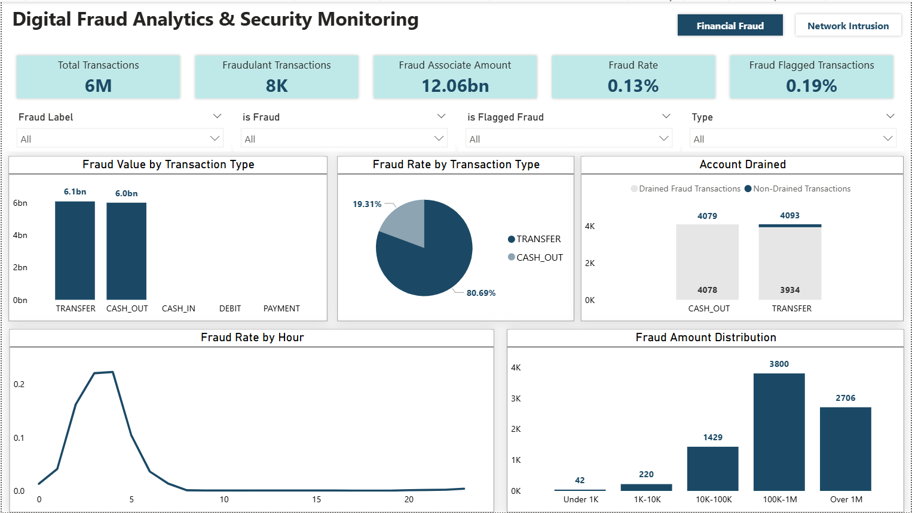
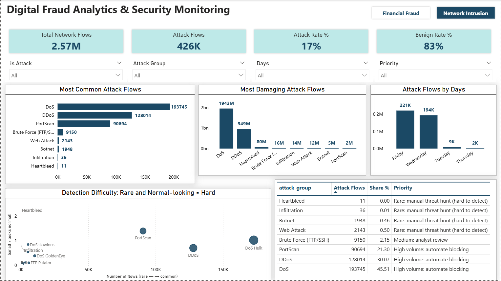

# Digital Banking Cyber Risk Analysis

### Financial Fraud & Network Intrusion Analytics Using Python

## Project Description

Digital banking institutions face multiple risks, ranging from fraudulent financial transactions to cybersecurity attacks targeting their digital infrastructure. Understanding these risks requires analyzing large volumes of financial and network data to identify suspicious patterns and prioritize potential threats.

This project explores two independent dimensions of digital banking risk using Python:

- **PaySim:** Financial transaction fraud analysis to understand fraudulent transaction patterns, transaction behavior, and potential financial exposure.
- **CICIDS2017:** Network intrusion analysis to examine attack distributions, network traffic characteristics, and potentially difficult-to-distinguish attack categories.

The objective is to transform large-scale raw datasets into meaningful analytical insights through data cleaning, exploratory data analysis, statistical comparisons, feature engineering, and retrospective risk prioritization.

The project focuses on understanding where risk is concentrated, identifying behavioral patterns, and exploring how analytical findings can support fraud investigation and cybersecurity risk assessment.

---

## Business Problem

Digital banking institutions process millions of transactions and network activities, where suspicious events represent a relatively small proportion of overall activity.

Identifying where these risks are concentrated is challenging because:

- Fraudulent transactions may follow specific transaction patterns and account behaviors.
- Different transaction types and amount ranges may have different levels of observed fraud.
- Cyberattacks vary significantly in frequency and network traffic characteristics.
- Rare attack categories may receive less attention despite their potential importance.
- Investigating every transaction and network event equally is not operationally practical.

The business challenge is to understand historical risk patterns and explore how analytical prioritization can help direct investigation efforts toward potentially higher-risk activities.

---

## Business Questions Answered

### Financial Fraud Analysis

- Which transaction types carry the highest fraud rate and highest fraud value?
- What percentage of total transaction volume and value is fraudulent, and what is the estimated financial loss?
- At what transaction amounts does fraud concentrate? Is there a "sweet spot" attackers prefer?
- What is the average and maximum fraud amount per transaction type, and where is the loss concentrated?
- Do fraudsters follow a signature pattern, such as TRANSFER followed by CASH_OUT, to drain accounts?

### Network Threat Analysis

- Which attack types are most common and most damaging?
- Which attacks are hardest to detect, and why?
- How do attackers' traffic behaviors differ from normal banking-like traffic?
- Are there time-based patterns (by hour, day, or step) when fraud peaks?

### Risk Prioritization
- How can the bank prioritize alerts so investigators focus on the highest-risk cases first?

---

## Data Sources

This project uses two independent public datasets.

### 1. PaySim – Financial Transaction Fraud Dataset

**Source:** [PaySim Dataset – Kaggle](https://www.kaggle.com/datasets/patelhiral/paysim-synthetic-financial-transactions-dataset)

PaySim is a synthetic financial transaction dataset designed to simulate mobile-money transactions and fraudulent activities.

### 2. CICIDS2017 – Network Intrusion Dataset

**Source:** [Canadian Institute for Cybersecurity – CICIDS2017](https://www.kaggle.com/datasets/patelhiral/cicids2017-network-intrusion-detection-dataset)

The MachineLearningCVE version of CICIDS2017 contains labelled network traffic records representing benign activities and multiple cyberattack categories.

---

## Tools and Tech Stack

| Tool | Purpose in This Project |
|---|---|
| Python 3 | Data analysis and cybersecurity risk investigation |
| Pandas | Data cleaning, transformation, aggregation, and analysis |
| NumPy | Numerical operations and statistical calculations |
| Matplotlib | Data visualization |
| Seaborn | Statistical and comparative visualizations |
| Power BI | Interactive dashboards and business-focused risk reporting |
| Jupyter Notebook | End-to-end analysis and documentation |
| Kaggle | Dataset access and notebook execution |

---

## Dashboard

### Financial Fraud Analysis

### Network Threat Analysis

